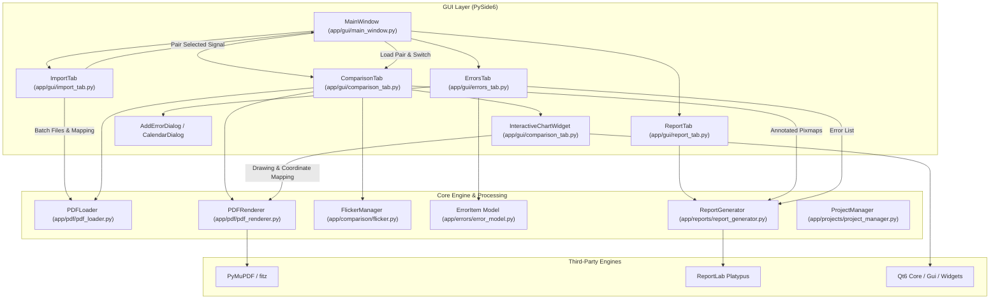
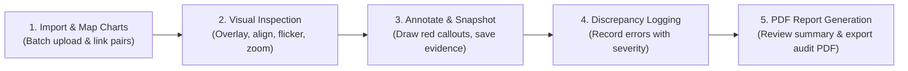

# AeroChart Inspector

> **Aeronautical Chart Quality-Control, Visual Comparison & Defect Audit System**  
> *Designed and Developed by **Sergo Kokolia***

[](https://www.python.org/)
[-green.svg)](https://wiki.qt.io/Qt_for_Python)
[-orange.svg)](https://pymupdf.readthedocs.io/)
[](https://www.reportlab.com/)
[]()
[]()

---

## 📌 Executive Summary

**AeroChart Inspector** is an enterprise-grade desktop quality assurance application purpose-built for aeronautical cartographers, Aeronautical Information Service (AIS) / Aeronautical Information Management (AIM) specialists, and aviation safety auditors. 

In aeronautical navigation, minor cartographic oversights—such as shifted obstacles, altered minimum safe altitudes (MSAs), misprinted radio communication frequencies, or misplaced waypoints—can introduce severe hazards to flight operations. **AeroChart Inspector** eliminates reliance on error-prone paper side-by-side checks and general-purpose PDF readers by providing a specialized visual comparison and audit environment. It allows inspectors to superimpose newly published chart revisions over legacy baselines, perform micro-spatial alignment, execute stroboscopic flicker comparisons, annotate visual discrepancies in real time, catalog categorized safety defects, and generate standardized, publication-ready PDF validation reports.

---

## 🛩️ Key Features & Capabilities

### 1. Batch Ingestion & Dynamic Chart Mapping (`Import Tab`)
- **Dual Ingestion Queues**: Bulk-import revised aeronautical charts (*Updated Charts*) alongside baseline publications (*Old Charts*).
- **Cartographic Pairing**: Easily link updated charts to their corresponding baseline counterparts.
- **Active Mappings Management**: Maintain a live list of linked pairs with inline editing, deletion, and quick-activation via double-click to immediately load the comparison workspace.
- **Single-Page Chart Strict Validation**: Guarantees chart standard integrity by verifying single-plate ICAO standards (IAC, SID, STAR, VFR, Aerodrome plates) before ingestion.

### 2. High-Precision Visual Comparison Workspace (`Chart Comparison Tab`)
- **Dual-Layer Superimposition**: Renders high-DPI vector PDF rasterizations (`PyMuPDF`) with smooth alpha blending between revised and baseline plates.
- **Overlay Balance Slider**: Seamlessly crossfade between the updated revision and the baseline chart (0% to 100% opacity).
- **Stroboscopic Flicker Comparator**: Alternates between the two charts at customizable intervals (`0.2s`, `0.5s`, `1.0s`, `2.0s`, `3.0s`) to trigger human optical motion detection, instantly revealing subtle shifts in text, coordinates, contour lines, or symbology.
- **Micro-Spatial Alignment (Drag Mode)**: Enables spatial registration by clicking and dragging the baseline chart relative to the updated chart, correcting printing offsets, coordinate shifts, or border margins.
- **Continuous Coordinate Transformation**: Zoom from **25% to 500%** using the mouse wheel or step buttons without losing spatial registration or annotation coordinates.
- **Freehand Red Markup Annotation**: Draw visual callouts (circles, arrows, bounding boxes) directly over defect areas on the canvas.
- **Multi-Snapshot Evidence Capture**: Save timestamped visual markup snapshots directly into the report queue.

### 3. Categorized Defect & Error Logging (`Errors Tab`)
- **Standardized Aviation Error Types**: Classify findings across 20 distinct aeronautical categories (e.g., *Altitude, Frequency, Navaid, Procedure, Obstacle, Terrain, Symbol, Geometry/Position, Missing Information, Formatting*).
- **Safety Impact Grading**: Categorize each defect by severity level:
  - 🔴 **Critical**: Poses immediate flight hazard or procedure compromise.
  - 🟠 **Major**: Significant discrepancy impacting operational usability or flight planning.
  - 🟡 **Minor**: Non-hazardous discrepancy, styling inconsistency, or label collision.
  - 🔵 **Observation**: Advisory note, cartographic recommendation, or drafting remark.
- **Full Audit Lifecycle**: Create, edit, and delete logged errors with automatic unique identifiers (`ERR-001`, `ERR-002`, ...), descriptions, affected chart bindings, and reviewer commentary.

### 4. Publication-Ready PDF Report Generation (`Report Tab`)
- **Quality Controller Attribution**: Enforces reviewer accountability with mandatory inspector credentials, customizable verification dates (via integrated calendar dialog), and internal Log Sheet reference numbers.
- **Session Verification Inventory**: Compiles all aeronautical charts inspected during the session into a structured checked charts manifest.
- **Executive Summary Metrics**: Real-time KPI summary tracking total defects categorized by severity.
- **Visual Evidence Annex**: Embeds high-resolution visual evidence captures with annotated red markings directly into the PDF report.
- **ReportLab PDF Engine**: Builds clean, publication-grade audit documents for compliance archives and cartography revision cycles.

### 5. Aviation Flight Deck Aesthetics
- **EFB Day Mode Design**: Custom Qt stylesheet modeled after modern Electronic Flight Bag (EFB) avionics interfaces, featuring high-contrast readability, slate blues, crisp cards, and clear typography.

---

## 🏛️ System Architecture



---

## 📂 Project Directory Structure

```plaintext
AeroChartInspector/
│
├── app/                                       # Core Application Source Code
│   ├── main.py                                # Application entry point & Qt event loop
│   ├── __init__.py                            # Package initialization
│   │
│   ├── config/                                # Configuration & Themes
│   │   ├── __init__.py
│   │   ├── settings.py                        # App metadata (version, title) & default styles
│   │   └── theme.py                           # Aviation Light Theme (EFB Day Mode QSS)
│   │
│   ├── comparison/                            # Comparison Automation
│   │   ├── __init__.py
│   │   └── flicker.py                         # FlickerManager timer and state switcher
│   │
│   ├── errors/                                # Discrepancy & Defect Models
│   │   ├── __init__.py
│   │   └── error_model.py                     # ErrorItem, ERROR_TYPES, and SEVERITY_LEVELS
│   │
│   ├── gui/                                   # Presentation & User Interface
│   │   ├── __init__.py
│   │   ├── main_window.py                     # Main tab coordinator & application shell
│   │   ├── import_tab.py                      # Batch chart upload & pair mapping
│   │   ├── comparison_tab.py                  # Interactive canvas, flicker, drag & draw
│   │   ├── errors_tab.py                      # Error logging table & management controls
│   │   ├── report_tab.py                      # QC metadata, summary counters & PDF trigger
│   │   └── dialogs.py                         # Add/Edit error dialogs & calendar pop-ups
│   │
│   ├── pdf/                                   # PDF Processing & Rendering
│   │   ├── __init__.py
│   │   ├── pdf_loader.py                      # File validation and PyMuPDF document loading
│   │   └── pdf_renderer.py                    # Vector-to-QPixmap high-DPI rasterization
│   │
│   ├── projects/                              # Project Serialization (Future / Extension)
│   │   ├── __init__.py
│   │   └── project_manager.py                 # JSON save/load state manager
│   │
│   ├── reports/                               # Reporting Subsystem
│   │   ├── __init__.py
│   │   └── report_generator.py                # ReportLab PDF compilation engine
│   │
│   └── utils/                                 # Auxiliary Utilities
│       └── __init__.py
│
├── Sample charts/                             # Sample ICAO Instrument Approach Charts
│   ├── AD 2.UGKO-IAC-07-ILSy_UPD.pdf          # Kutaisi RWY 07 ILSy (Updated Revision)
│   ├── UG-AD-2-UGKO-...-RWY-07-(ILSy) (1).pdf # Kutaisi RWY 07 ILSy (Baseline/Old)
│   ├── AD 2.UGKO-IAC-07-VOR_UPD.pdf           # Kutaisi RWY 07 VOR (Updated Revision)
│   ├── UG-AD-2-UGKO-...-RWY-07-(VOR).pdf      # Kutaisi RWY 07 VOR (Baseline/Old)
│   └── AeroChart_Inspector.mp4                # Video demonstration
│
├── Full package/                              # Distribution Artefacts & Documentation
│   ├── AeroChartInspector.exe                 # Compiled Windows Standalone Executable
│   ├── AeroChart_Inspector.mp4                # Video walkthrough
│   ├── AeroChart_Inspector_Ingestion_...pptx  # Training & Onboarding Slide Deck
│   ├── Manual.docx                            # Official Technical & User Manual
│   └── Visual_Inspection_Toolbar_Guide.png    # High-resolution toolbar visual reference
│
├── AeroChartInspector.spec                    # PyInstaller build specification
├── requirements.txt                           # Python package dependencies
└── README.md                                  # Comprehensive project documentation
```

---

## 🛠️ Technology Stack

| Component | Technology | Description |
| :--- | :--- | :--- |
| **Language** | Python 3.10+ | Core development language |
| **User Interface** | PySide6 (Qt for Python 6) | High-performance desktop GUI, custom canvas rendering (`QPainter`) |
| **PDF Ingestion & Rendering** | PyMuPDF (Fitz) | Blazing-fast PDF parsing and antialiased rasterization to `QPixmap` |
| **Report Generation** | ReportLab | Programmatic vector PDF compilation, tables, and image embedding |
| **Styling** | Qt Style Sheets (QSS) | Tailored EFB Day Mode palette with aviation ergonomics |
| **Packaging** | PyInstaller | One-file Windows executable packaging |

---

## 🚀 Installation & Getting Started

### Prerequisites
- **Operating System**: Windows 10/11 (or macOS / Linux with Qt6 support)
- **Python**: Version `3.10` or newer installed on your PATH

### Setup from Source

1. **Clone or Navigate to the Repository**:
   ```bash
   cd "e:/VS Code/CHARTING validator/Chart inspector/AeroChartInspector"
   ```

2. **Create and Activate a Virtual Environment**:
   ```powershell
   # Windows PowerShell
   python -m venv .venv
   .venv\Scripts\Activate.ps1
   ```

3. **Install Dependencies**:
   ```bash
   pip install -r requirements.txt
   ```

4. **Launch the Application**:
   ```bash
   python -m app.main
   ```

---

## 📖 Operational Workflow & Guide



### Stage 1: Ingestion & Chart Pairing (`Import` Tab)
1. Navigate to the **Import** tab.
2. Click **Upload Updated PDFs** to select newly revised charts.
3. Click **Upload Old PDFs** to select baseline comparison charts.
4. From the dropdown menus, select the matching Updated and Old charts, then click **Link Selected Pair**.
5. Once mapped, double-click any item in the **Active Mappings List** to automatically open both charts in the **Chart Comparison** tab.

### Stage 2: Visual Inspection & Comparison (`Chart Comparison` Tab)
- **Direct Selection**: Alternatively, use the top **Browse...** buttons to load individual charts on the fly.
- **Click Load Charts**: Renders both plates onto the interactive canvas.
- **Overlay Balance Slider**: Drag the slider left or right to inspect changes by varying the opacity of the old baseline chart over the updated version.
- **Flicker Comparison**: Click **Start Flicker** to alternate views automatically. Adjust the interval (`0.2s` to `3.0s`) using the dropdown to highlight micro-differences.
- **Spatial Alignment (Drag Mode)**: If chart borders or georeferenced coordinates are misaligned:
  1. Click **Drag Mode: OFF** (turns red: `Drag Mode: ON`).
  2. Click and drag on the canvas to nudge the baseline chart into exact spatial alignment with the updated chart.
  3. Click **Drag Mode** again to lock the alignment. Click **Reset Alignment** at any time to return to origin `(0, 0)`.
- **Zoom & Pan**: Use the mouse wheel or the `+` / `-` / `Fit` buttons to inspect fine cartographic details (from 25% to 500%). Use the scrollbars to pan across high-magnification regions.

### Stage 3: Annotation & Evidence Capture
1. Click **Draw Highlight: OFF** to toggle drawing mode (cursor changes to a crosshair).
2. Click and drag over the chart to draw red annotations around identified discrepancies.
3. Click **Save Annotated Chart to Report** to capture a snapshot of the current view with your annotations. The snapshot is appended to the PDF report evidence list.
4. Click **Clear Drawings** if you wish to remove temporary annotations.

### Stage 4: Error & Discrepancy Logging (`Errors` Tab)
1. Switch to the **Errors** tab and click **Add Error**.
2. Fill in the modal dialog:
   - **Error ID**: Auto-generated sequential tag (e.g., `ERR-001`).
   - **Error Type**: Select from 20 standardized aeronautical categories.
   - **Severity**: Choose `Critical`, `Major`, `Minor`, or `Observation`.
   - **Affected Chart**: Automatically inherits the active updated chart filename.
   - **Description**: Detailed description of the cartographic defect.
   - **Comments**: Optional references, ICAO standards, or corrective instructions.
3. Click **Save** to add the defect to the audit table.
4. Use **Edit Selected Error** or **Delete Selected Error** to manage log entries.

### Stage 5: Summary & Audit Report Export (`Report` Tab)
1. Enter the **Quality Controller's Name and Surname** (mandatory).
2. Review or update the **Validation Date** (use **Select Date...** for the calendar dialog).
3. Enter the internal **Log Sheet Number(s)**.
4. Under **List of Checked Charts**, click **Add Chart(s)...** to include all plates reviewed in this session.
5. Review the **Validation Review Summary** widget for live metrics on total errors and severity breakdowns.
6. Click **Generate PDF Report**, choose the file destination, and export your formal audit document.

---

## 🎯 Defect Taxonomy & Severity Matrix

### Error Categories (`ERROR_TYPES`)
The system provides 20 domain-specific categories covering all aspects of aeronautical publication:
- **Navigation & Flight Operations**: `Altitude`, `Frequency`, `Navaid`, `Course / Bearing`, `Distance`, `Speed`, `Procedure`, `Route`, `Waypoint`
- **Aerodrome & Physical Environment**: `Runway`, `Aerodrome`, `Obstacle`, `Terrain`
- **Cartographic Drafting & Standards**: `Text`, `Symbol`, `Geometry / Position`, `Missing Information`, `Incorrect Information`, `Formatting / Presentation`, `Other`

### Severity Scale
| Severity | Description | Action Required |
| :--- | :--- | :--- |
| 🔴 **Critical** | Errors that violate flight safety, obstacle clearance, or procedure minimums (e.g., wrong DA/MDA, incorrect frequency). | **Immediate publication hold**; chart must be corrected before release. |
| 🟠 **Major** | Significant operational discrepancies (e.g., missing navaid identifier, incorrect waypoint fix name). | Corrective revision required prior to operational cycle effective date. |
| 🟡 **Minor** | Drafting, cosmetic, or styling discrepancies (e.g., text overlap, line weight, font size). | Non-safety impact; correct during current or subsequent cycle. |
| 🔵 **Observation** | Quality control suggestions, notes, or cartographic recommendations. | Review by chief cartographer for drafting standard updates. |

---

## 📦 Building Standalone Executable

To compile a self-contained, single-file Windows executable (`AeroChartInspector.exe`) using PyInstaller:

```bash
# Ensure PyInstaller is installed
pip install pyinstaller

# Build using the provided specification file
pyinstaller AeroChartInspector.spec
```

The resulting binary will be output to:
```
dist/AeroChartInspector.exe
```
This standalone executable requires no local Python installation and includes all Qt libraries, PyMuPDF binaries, and ReportLab assets.

---

## 🧪 Sample Data

Sample ICAO Instrument Approach Charts are included in the [`Sample charts/`](file:///e:/VS%20Code/CHARTING%20validator/Chart%20inspector/AeroChartInspector/Sample%20charts) directory for testing and demonstration:
- **Kutaisi Airport (UGKO)**:
  - `AD 2.UGKO-IAC-07-ILSy_UPD.pdf` vs. `UG-AD-2-UGKO-...-RWY-07-(ILSy) (1).pdf`
  - `AD 2.UGKO-IAC-07-VOR_UPD.pdf` vs. `UG-AD-2-UGKO-...-RWY-07-(VOR).pdf`
- **Demo Video**: `AeroChart_Inspector.mp4`

---

## 👨‍💻 Author & Credits

- **Architect & Lead Developer**: **Sergo Kokolia** (`kokoliakoko@gmail.com`)
- **Domain**: Aeronautical Cartography, AIS/AIM Data Validation, Instrument Procedure Design QC
- **Release**: Version 1.0.0
